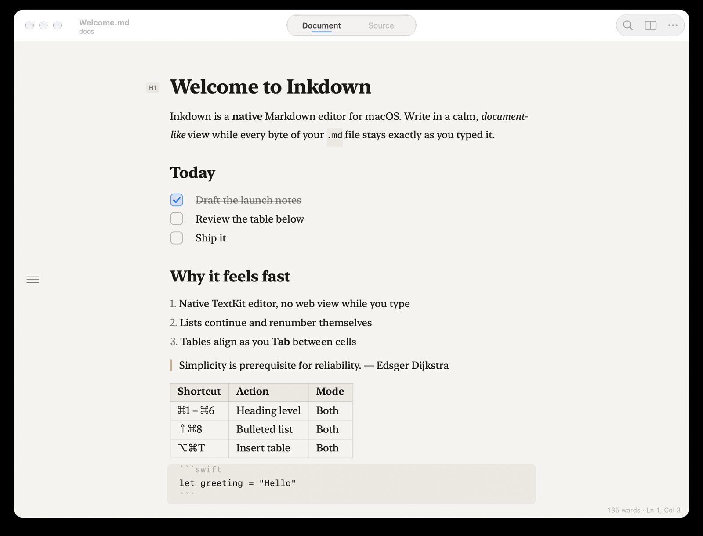

# Parchly

A calm, native Markdown editor for macOS: **edit, create, view and Quick Look** `.md` files.
The look follows [Downright](https://downright.cc). The goal is that every feature just works.

**Website:** https://tapariapurv.github.io/parchly/ · **Film:** [Parchly in 37 seconds](https://tapariapurv.github.io/parchly/#film)



## Install

**One line.** Paste into Terminal:

```sh
curl -fsSL https://tapariapurv.github.io/parchly/install.sh | bash
```

This downloads the [latest release](https://github.com/tapariapurv/parchly/releases/latest), installs it into `/Applications`, turns on the Quick Look extension and opens the app. ([Read the script](docs/install.sh).)

**Or** download [`Parchly.dmg`](https://github.com/tapariapurv/parchly/releases/latest/download/Parchly.dmg) and drag the app into Applications. The build isn't notarized yet, so on first launch go to **System Settings › Privacy & Security › Open Anyway**.

Requires macOS 14 Sonoma or later (Apple silicon or Intel). To uninstall, drag Parchly to the Trash.

## Features

- **Home**: new document, open, new from clipboard, the guide and your recent documents in one compact window. It appears at launch and when you close the last document, or press ⇧⌘H. Drop files on it to open them.
- **Document mode** (looks like Downright, edits like Bear): Markdown syntax hides as you read and comes back on the line you're editing. Serif page, H1–H6 margin badge, • bullets, clickable checkboxes, quote bars, table grids, inline code pills and images.
- **Formatting bar**: a floating Liquid Glass bar with every Markdown tool (headings, bold, italic, strike, code, link, lists, tasks, quote, code block, table, divider). You don't need to know the syntax. Toggle it with ⇧⌘B.
- **Source mode** (⌃⌘2): monospace Markdown, with optional line numbers in Settings.
- **Side-by-side preview** (⌘\): GitHub-style rendering with KaTeX math, Mermaid diagrams and colour-coded code, scroll-synced and theme-aware.
- **Smart editing**: type `[]` and a space to start a task, list continuation and renumbering, Tab/Shift-Tab nesting, table cell navigation with auto-formatting, wrap-on-type (select text and type `*`, `_`, `` ` ``, `~`, `=`), bracket auto-pairing, paste a URL to make a link.
- **Cross-references**: `[[Note]]`, `[[Note|Label]]`, `[[Note#Heading]]` and `[text](#heading)`. ⌘-click follows a link and creates missing notes.
- **Themes**: Paper (auto light/dark, matching Downright), Paper Light, Warm Dark, Nord, Solarized Light/Dark, High Contrast, Sepia, Forest and Midnight.
- **Settings** (⌘,): theme, text size, formatting bar, line numbers, spelling, updates.
- **Automatic updates** via Sparkle (signed appcast), plus **Check for Updates…**.
- **Quick Look extension**: press Space on any `.md` in Finder.
- **Files & outline sidebar** (on by default, toolbar button or ⌃⌘S): ⌘P finds any Markdown file in the folder, and ⇧⌘O jumps to a heading.
- **Plain files only**: no database, sandboxed, autosave, Versions, Rename/Move, external-change reload, export to PDF/HTML, Print.
- **Getting started**: a built-in guide opens on first launch (Help › Markdown Guide).

### Markdown support

| Element | Editor | Preview / export | Quick Look |
| --- | --- | --- | --- |
| Headings (ATX + setext), emphasis, links, images | ✓ | ✓ | ✓ |
| Lists, nested lists, task lists | ✓ | ✓ | ✓ |
| Tables with alignment | ✓ | ✓ | ✓ |
| Code spans, fenced code with syntax colouring | ✓ | ✓ | ✓ |
| Blockquotes, GitHub alerts (`> [!NOTE]`) | ✓ | ✓ | ✓ |
| Strikethrough, autolinks, footnotes, raw HTML, front matter | ✓ | ✓ | ✓ |
| `==highlight==`, `:emoji:`, heading anchors | ✓ | ✓ | ✓ |
| `[[Wiki links]]` and cross-references | ✓ | ✓ | ✓ |
| Math `$…$` / `$$…$$` (KaTeX) | ✓ | ✓ | as source |
| Mermaid diagrams | ✓ | ✓ | as source |

## Keyboard shortcuts

| Action | Keys | Action | Keys |
| --- | --- | --- | --- |
| Bold / Italic | ⌘B / ⌘I | Heading 1–6 / Body | ⌘1–⌘6 / ⌘0 |
| Strikethrough | ⇧⌘X | Bulleted / Numbered list | ⇧⌘8 / ⇧⌘7 |
| Inline code | ⌃` | Task list / Toggle done | ⇧⌘9 / ⌘L |
| Link | ⌘K | Quote / Code block | ⌥⌘Q / ⌥⌘C |
| Insert table | ⌥⌘T | Indent / Outdent | ⌘] / ⌘[ |
| Move line up / down | ⌃⌘↑ / ⌃⌘↓ | Duplicate line | ⇧⌘D |
| Document / Source | ⌃⌘1 / ⌃⌘2 | Side-by-side preview | ⌘\ |
| Go to file / heading | ⌘P / ⇧⌘O | Find / Replace | ⌘F / ⌥⌘F |
| Toggle sidebar | ⌃⌘S | Reveal in Finder | ⌥⌘R |
| Export PDF / HTML | File menu | Print | ⌥⌘P |
| Home | ⇧⌘H | | |

All standard macOS text-editing shortcuts (word and line navigation, Emacs bindings, undo/redo) work too.

## Build

Maintainers can cut a release (it builds, packages a DMG and zip, tags, and publishes with notes from `release-notes/vX.Y.Z.md`) with:

```sh
scripts/release.sh 1.0.1
```

To build from source yourself:

Requires macOS 14+, Xcode 16+ and [XcodeGen](https://github.com/yonaskolb/XcodeGen).

```sh
brew install xcodegen
xcodegen                                   # generates Parchly.xcodeproj from project.yml
xcodebuild -scheme Parchly -configuration Release -derivedDataPath build
cp -R build/Build/Products/Release/Parchly.app /Applications/
```

Set `DEVELOPMENT_TEAM` in `project.yml` to your own team ID to sign with your certificate.

### Quick Look

The extension registers when the app is first launched from `/Applications`. If another app (for example Downright) also previews Markdown, macOS uses whichever extension is enabled. Pick Parchly in **System Settings › General › Login Items & Extensions › Quick Look**, or from the terminal:

```sh
pluginkit -e use -i com.purvt.ParchlyQuickLook
qlmanage -r
```

## Mac App Store

Parchly runs in the App Sandbox and includes a privacy manifest (no data collected). The App Store listing (metadata, keywords, captioned screenshots, review notes) is in [`appstore/`](appstore/), along with [`scripts/appstore.sh`](scripts/appstore.sh) for archiving and uploading. Submitting requires a paid Apple Developer Program membership; see [appstore/README.md](appstore/README.md).

## Tests

```sh
scripts/test.sh
```

This runs four suites:
- **Editing rules** (`Tests/main.swift`): list continuation and renumbering, toggles, table formatting and navigation, code fences.
- **Live editor** (`Tests/editor.swift`): drives the real text view in both modes. It covers typing, smart Return/Tab/Backspace, wrap and auto-pair, undo/redo, copy/cut/paste (including rich text and URLs), every format command, clicking checkboxes and links, wrap indents, caret clamping, round-trip fidelity, incremental fence tracking, and a 1 MB performance check (about 7 ms per keystroke on an idle Mac).
- **Renderer**: alerts, math, highlights, wiki links, emoji, code colouring and task lists, run through the app's `--render-html` hook.
- **App self-test** (`App/SelfTest.swift`, Debug build): `Parchly --selftest` opens real documents and checks saving, reverting, the sidebar, links, pasted images, Find, modes, the preview, themes, settings and Home. It also clicks every formatting-bar button and fires every menu command, checking exact undo.

For screenshots without touching the screen, a Debug build renders windows offscreen: `Parchly --snapshot home|doc [preview] [source] [dark] < note.md > out.png`.

## Project layout

| Path | What |
| --- | --- |
| `App/MarkdownLogic.swift` | Pure line-level rules: list continuation/renumbering, toggles, GFM table formatting and navigation, fence detection |
| `App/Styling.swift` | Live styler (Document/Source) and the layout manager that hides syntax, swaps bullets, and draws checkboxes, grids, quote bars and margins |
| `App/Editor.swift` | `NSTextView` subclass (smart keys, format commands) and the editor controller |
| `App/Window.swift` | `NSDocument`, window/toolbar, preview (`WKWebView`), export and print |
| `App/Sidebar.swift` | SwiftUI files & outline sidebar |
| `App/Home.swift` | Home window: actions, recent documents, drop to open |
| `App/SelfTest.swift` | Debug-only `--selftest`: drives documents, windows, menus and settings in-process |
| `Shared/Renderer.swift` | cmark-gfm → HTML plus CSS, shared by the preview and Quick Look |
| `QuickLook/` | Data-based Quick Look preview extension |
| `docs/` | Website (GitHub Pages) |

## License

MIT
